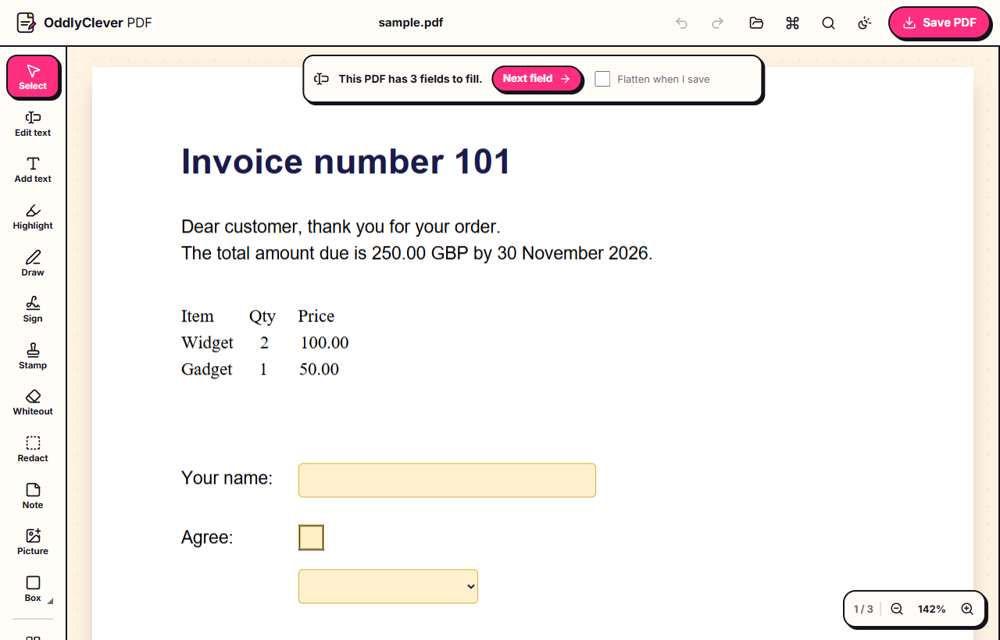
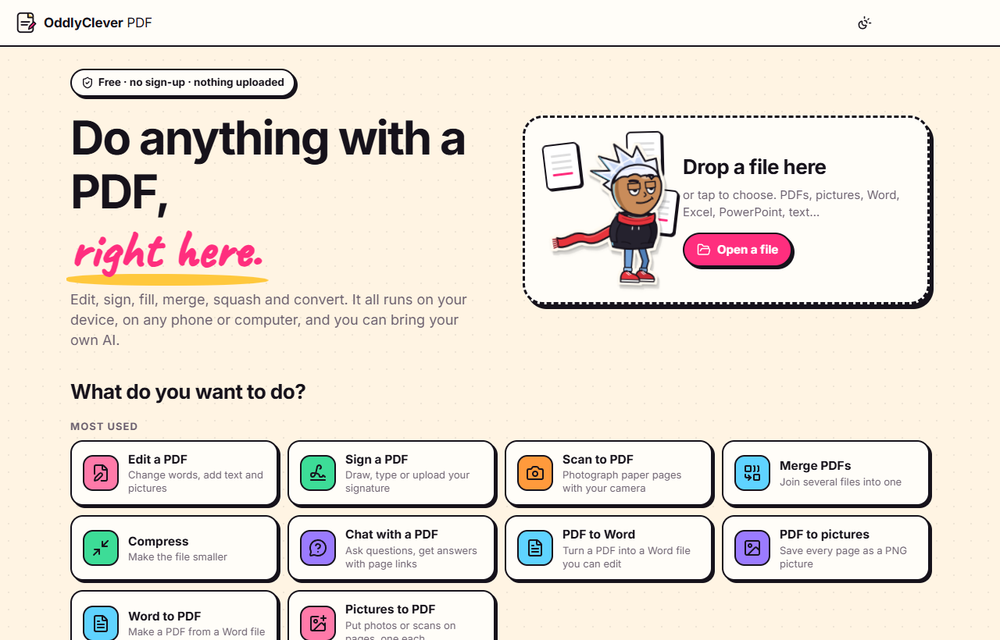
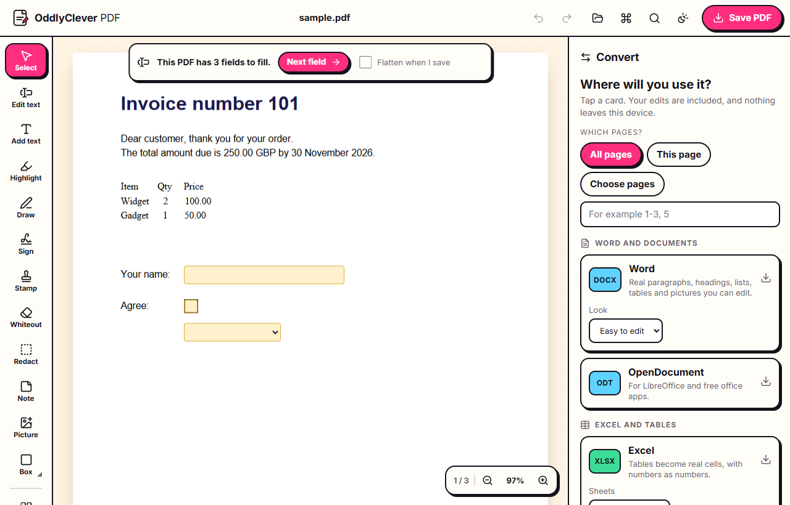
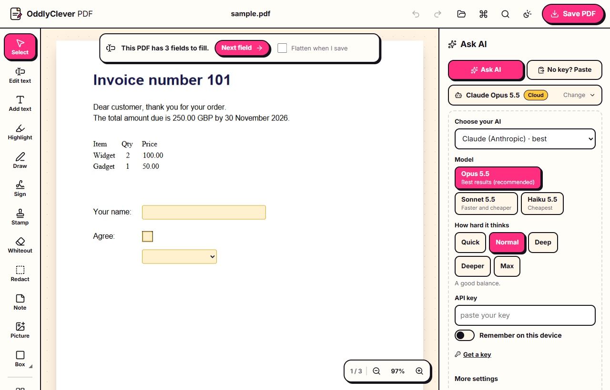
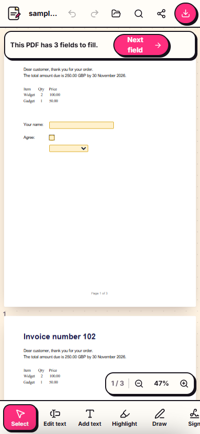

# OddlyClever PDF

I needed to change one number on a PDF, and every site wanted me to sign up, upload my file, or pay before the download. So I built my own PDF editor.

It's free, it runs in your browser, and you don't make an account. Edit, sign, fill in, merge, squash and convert PDFs on your phone or your computer. There's no server: your files never leave your device. No watermark, no daily limit, and it works offline once it's loaded.

**Use it now: [oddlyclevertools.github.io/OddlyCleverPDF](https://oddlyclevertools.github.io/OddlyCleverPDF/)** (works on phones too; tap "Install app" to keep it on your home screen).

[](https://ko-fi.com/oddlyclevertools)



## What it does

- **Edit the PDF's own words.** Tap any line and type. It matches the font, size and colour. You can also add text, pictures, drawings, highlights, underlines, strike-throughs, boxes, arrows, sticky notes (real PDF comments) and whiteout.
- **Fill in and sign.** Real form fields get proper boxes to type in, and flat forms work too: type anywhere, or add ticks, crosses and today's date. Sign by drawing with your finger, typing your name, or uploading a photo of your signature. Saved signatures stay on your device. There are stamps too (Approved, Paid, Draft, Confidential and your own).
- **Pages.** Drag to reorder, rotate, delete, duplicate, insert blank pages or pages from another file, extract, split, merge and crop.
- **Make it smaller.** Three levels, and it shows you the size before and after.
- **Watermarks, page numbers, headers and footers.**
- **Password protect** with printing and copying rules, or save an unlocked copy of a PDF you have the password for.
- **Redaction that really removes things.** Redacted areas are wiped out, not just covered, and the app checks the saved file to prove the hidden text is gone.
- **Convert PDF to:** Word, Excel, CSV, PowerPoint, PNG, JPG, WebP, text, Markdown, HTML, RTF, EPUB, ODT, JSON, a print-ready PDF or a greyscale PDF. Word rebuilds real paragraphs, headings, lists and tables, and Excel puts tables into real cells.
- **Convert to PDF:** Word, Excel, PowerPoint, OpenDocument, Markdown, HTML, text, CSV, RTF, SVG and pictures. Drop a mix of files and they become one PDF.
- **Scan with your phone camera.** Take photos of paper, and it finds the page, straightens it, cleans it to black and white and makes a PDF.
- **Read text in scans (OCR)** in many languages, so scanned PDFs become searchable and copyable.
- **Bring your own AI.** Ask about your PDF ("summarise this", "find the dates and money") and get answers with links to the right pages. Or ask it to change things: fix spelling, fill a form, highlight the important parts, redact personal details, translate, rotate or reorder pages, add a summary page. One Undo takes back everything it did. It works with Claude, OpenAI, Gemini, OpenRouter, Groq, Mistral, DeepSeek and B.AI with your own key, with free local models on your computer (Ollama, LM Studio, llama.cpp), or with no key at all by pasting into any AI chat. Your key stays in memory unless you tick "Remember", and your PDF's text goes only to the AI you pick.
- **Made for beginners.** It starts with "What do you want to do?", and everything is in plain words. Press Ctrl+K to find any tool. Undo works everywhere, and it autosaves, so a closed tab loses nothing.
- **On phones:** pinch to zoom, the tools sit along the bottom, and panels slide up. You can share straight from your phone's share sheet.

| Home | Convert | Ask AI | On a phone |
|---|---|---|---|
|  |  |  |  |

## Good to know

- **Edit text covers the old words; it doesn't erase them.** The new words are real text, but the old ones are still inside the file underneath, so someone could copy them out. For anything private, use **Redact**: it removes them for good.
- Fonts are embedded whole, so an edited file can grow by 100–300 KB.
- OCR downloads its language data (about 10 MB per language) the first time, and only after you say yes.

## Run it on your own computer

You don't need to; the link above is the whole app. But if you want to change it, you need [Node.js](https://nodejs.org) 20 or newer.

```bash
npm install
```

```bash
npm run dev
```

Then open http://127.0.0.1:5185. `npm test` runs the tests, and `npm run build` makes the static site in `dist/`, which you can host anywhere.

How the code is laid out: `src/core` holds the document, opening and saving; `src/viewer` shows the pages; `src/tools` holds the page tools; `src/ui` is the interface. The bigger features each live in their own folder in `src/features/` (pages, convert, ai, forms). `docs/CONTRACT.md` explains how a feature plugs in.

## Licence

The code is MIT (see [LICENSE](LICENSE)). The Oddly Clever name, logo and characters aren't part of that; see [TRADEMARKS.md](TRADEMARKS.md). Third-party parts and their licences are listed in [THIRD_PARTY.md](THIRD_PARTY.md).

Made by [Oddly Clever Tools](https://www.youtube.com/@oddlyclevertools). Found a bug or want something added? Open an issue. I read them all.
